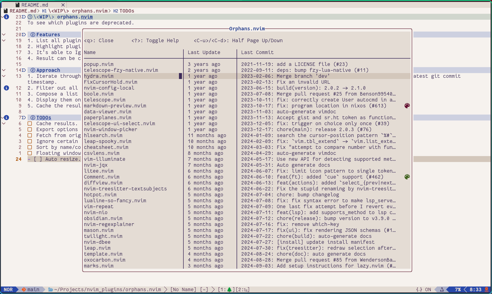

# Orphans.nvim
Track neglected plugins and rediscover the overlooked in your Neovim setup.


## Motivation
The `lazy.nvim` plugin manager is great, but it's not always convenient to find plugins that are not actively maintained.

This plugin provides a list of plugins sorted by the last commit date, which can help you find plugins that are not actively maintained.

For plugins that are **done**, which means they are stable and don't require frequent updates, you can ignore them using `ignored` option.

## Features
1. List all plugins ordered by the latest update time. 
2. It's able to Ignore certain plugins.
3. Highlight plugins that are not maintained actively. (coming soon)
4. Result can be cached. (coming soon)

## Installation
Use `lazy.nvim` to install the plugin:
```lua
{
    "ZWindL/orphans.nvim",
    config = function()
        require('orphans').setup({})
    end
}
```
## Usage
Use `:Orphans` to list all plugins.

Currently, `orphans` has its limitation. It will not pull the latest commit info from GitHub, so you need to update the plugin manually using whatever plugin manager.

## Configurations
```lua
require('orphans').setup({
    ui = {
        date_format = "%Y-%m-%d", -- the format of the last commit date
    },
    analyzing_timeout = 2000,   -- the timeout for the analysis for each plugin in ms
    ignored = {  -- the list of plugins to be ignored
        "orphans.nvim" -- e.g. "orphans.nvim", due to the implementation problem, only plugin name is supported, more formats to be supported in the future release
    }, 
    debug = false,
})
```

## Approach
1. Iterate through all `rtp` directories one by one, check if it's a git repo, has either `lua/` or `plugin/`, then retrieve the latest git commit timestamp.
2. Filter out all plugin dirs and combine the meta info (date time, name, commit message, etc.)
3. Compose a list of all plugins and sort them lively while retrieving the info of the remaining plugins.
4. Display them on a floating window. Expand one item for more details.
5. Cache the result.

## TODOs
- [ ] Cache results.
- [ ] Export options for progress bar UI.
- [ ] Fetch from origin automatically.
- [ ] Sort by name/commit time.
- [x] Ignore certain plugins.
